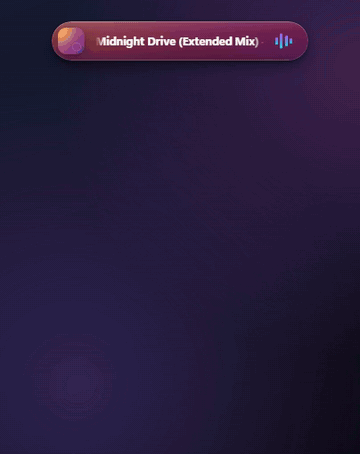

# Music Island

**English** · [Русский](README.ru.md)

A Dynamic Island–style widget for Windows that controls the music playing in your browser:
**SoundCloud, Spotify, YouTube Music and Apple Music**. It sits on top of everything, shows the
track, a timeline, playback controls, volume and the *Next Up* queue, and folds into a small pill
when you don't need it.

<p align="center"></p>

## Why

My second monitor is always split between two apps, one on each half of the screen, so there was
no room left for a browser tab with the player. Switching tabs on the main monitor just to change a
track kept pulling me out of what I was doing. So I made a widget: it lives on the second monitor,
and from there I can skip a track, change the volume and see what plays next without ever leaving
the main screen.

## Features

- **Now playing** — artwork, title (scrolls when it is long), artist, animated equalizer.
- **Timeline** with click-to-seek, elapsed and remaining time.
- **Controls** — shuffle, previous, play/pause, next, like.
- **Next Up** — the upcoming queue; click a track to play it.
- **Tab volume** — changes the volume of the player tab only, not of Windows. Mouse wheel over the
  island = ±5 %, speaker icon = mute.
- **Pill mode** — collapses to artwork + title + equalizer. Collapse on pause, always or never;
  double-click the card to fold it at any time, click the pill to open it.
- **Looks** — glass tinted by the artwork, four gradient backgrounds or plain black; nine colours
  for the progress bar and equalizer.
- **Tray icon** — the island is not in the taskbar; left-click the tray icon to hide/show it,
  right-click for settings.
- **Size** 70–160 % (Ctrl + wheel), position is remembered, English and Russian UI.
- **Light** — a fraction of a percent of CPU while music plays, nothing when paused; ~80 MB of RAM.

## Supported services

| Service | Track & controls | Seek | Volume | Queue | Like | Shuffle |
|---|---|---|---|---|---|---|
| SoundCloud | ✓ | ✓ | ✓ | ✓ | ✓ | ✓ |
| YouTube Music | ✓ | ✓ | ✓ | ✓ | ✓ | one-off shuffle of the queue |
| Spotify | ✓ | ✓ | ✓ | ✓ | add only ¹ | turn on only ¹ |
| Apple Music | ✓ | ✓ | ✓ | ✓ | — ² | ✓ |

¹ Spotify ignores scripted clicks for leaving smart shuffle, and un-liking opens its playlist dialog,
so these are switched off in Spotify itself. ² Liking needs a signed-in Apple ID and Apple's API.

Only the **web players in Chrome** are supported (open.spotify.com, music.youtube.com,
music.apple.com, soundcloud.com), not the desktop apps. If several player tabs are open, the island
follows the one that started playing last.

## Install

1. **App.** Download `MusicIsland-<version>-portable.exe` from the
   [Releases](../../releases) page and run it. The file is not code-signed, so Windows SmartScreen
   may warn you: *More info → Run anyway*.
2. **Chrome extension.** The extension is not in the Chrome Web Store yet, so it is loaded by hand:
   - download `MusicIsland-Bridge-<version>.zip` from the same [Releases](../../releases) page
     and unpack it;
   - open `chrome://extensions`, turn on **Developer mode**;
   - **Load unpacked** → choose the unpacked `music-island-bridge` folder.

   Keep the folder where it is: Chrome loads the extension from it every time it starts.
3. Open SoundCloud, Spotify, YouTube Music or Apple Music in Chrome and start a track.

To start the island with Windows, put a shortcut to the `.exe` into `shell:startup`.

## Using it

| Action | How |
|---|---|
| Move | drag the card anywhere except buttons, bars and the queue |
| Resize | Ctrl + mouse wheel, or right-click → size |
| Volume | mouse wheel over the card |
| Collapse / expand | double-click the card / click the pill |
| Settings | right-click the island or the tray icon |
| Hide / show | left-click the tray icon |

Windows 11 puts new tray icons under the **^** arrow; drag the icon to the taskbar to keep it visible.

## Run from source

Requires Windows 10/11 and [Node.js](https://nodejs.org) 18+.

```powershell
cd desktop-app
npm install
npm start
```

Or double-click `start-island.vbs` (no console window). Build the portable `.exe` with
`npm run dist`; it appears in `dist/`.

## How it works

```
player tab (content script) ──▶ extension service worker ──WebSocket 127.0.0.1:5055──▶ Electron app
```

The extension reads the player in the page and executes its buttons; the app shows the state and
sends commands back. Each service has its own adapter in `browser-extension/adapters/`;
YouTube Music and Apple Music also use a small helper inside the page (`browser-extension/page/`)
to reach their player APIs.

**Privacy.** Everything stays on your computer: the extension only talks to `127.0.0.1`, and the
app accepts connections only from browser extensions, not from web pages. No accounts and no
analytics; the only thing the app downloads is the artwork, from the music service's own servers.

## Limitations

- Windows only; Chrome only (other Chromium browsers are untested).
- Player websites change their markup from time to time; an update may be needed when they do.
- *Next Up* shows the part of the queue the service itself has loaded (usually 20–60 tracks).

## Disclaimer

Music Island is an independent project and is not affiliated with SoundCloud, Spotify, Google or
Apple. All product names and trademarks belong to their owners.

## License

[MIT](LICENSE)
