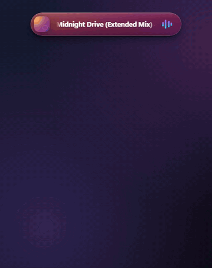

# Music Island

[English](README.md) · **Русский**

Виджет для Windows в стиле Dynamic Island, который управляет музыкой в браузере:
**SoundCloud, Spotify, YouTube Music и Apple Music**. Висит поверх всех окон, показывает трек,
таймлайн, кнопки управления, громкость и очередь *Next Up*, а когда не нужен — сворачивается
в маленькую пилюлю.

<p align="center"></p>

## Зачем

На втором мониторе у меня всегда открыты два приложения — каждое на свою половину экрана, поэтому
вкладку с плеером ставить было некуда. А переключать вкладки на основном мониторе ради смены трека —
значит каждый раз отвлекаться от того, чем занят. Поэтому я сделал виджет: он живёт на втором
мониторе, и прямо там можно переключить трек, поменять громкость и посмотреть, что играет дальше,
не уходя с основного экрана.

## Возможности

- **Что играет** — обложка, название (длинное прокручивается), исполнитель, эквалайзер.
- **Таймлайн** с перемоткой по клику, прошедшее и оставшееся время.
- **Кнопки** — перемешать, назад, играть/пауза, вперёд, лайк.
- **Next Up** — очередь; клик по треку запускает его.
- **Громкость вкладки** — меняется громкость только вкладки с плеером, а не всей системы. Колесо
  мыши над островком — ±5 %, иконка динамика — mute.
- **Пилюля** — свёрнутый вид: обложка + название + эквалайзер. Сворачивать на паузе, всегда или
  никогда; двойной клик по карточке сворачивает её в любой момент, клик по пилюле — разворачивает.
- **Оформление** — стекло, подсвеченное цветом обложки, четыре градиентных фона или чёрный;
  девять цветов полосы прогресса и эквалайзера.
- **Трей** — островка нет в панели задач; левый клик по значку прячет/показывает его, правый —
  настройки.
- **Размер** 70–160 % (Ctrl + колесо), позиция запоминается, интерфейс на русском и английском.
- **Лёгкий** — во время игры доли процента CPU, на паузе ноль; ~80 МБ памяти.

## Поддерживаемые сервисы

| Сервис | Трек и кнопки | Перемотка | Громкость | Очередь | Лайк | Перемешивание |
|---|---|---|---|---|---|---|
| SoundCloud | ✓ | ✓ | ✓ | ✓ | ✓ | ✓ |
| YouTube Music | ✓ | ✓ | ✓ | ✓ | ✓ | разовое перемешивание очереди |
| Spotify | ✓ | ✓ | ✓ | ✓ | только поставить ¹ | только включить ¹ |
| Apple Music | ✓ | ✓ | ✓ | ✓ | — ² | ✓ |

¹ Spotify игнорирует нажатия из скрипта при выходе из «умного перемешивания», а снятие лайка
открывает у него окно выбора плейлиста — поэтому выключаются они в самом Spotify.
² Для лайка нужен вход в Apple ID и API Apple.

Поддерживаются только **веб-плееры в Chrome** (open.spotify.com, music.youtube.com,
music.apple.com, soundcloud.com), не десктопные приложения. Если открыто несколько вкладок с
плеерами, островок следит за той, что начала играть последней.

## Установка

1. **Приложение.** Скачай `MusicIsland-<версия>-portable.exe` на странице
   [Releases](../../releases) и запусти. Файл не подписан, поэтому Windows SmartScreen может
   предупредить: *Подробнее → Выполнить в любом случае*.
2. **Расширение Chrome.** В Chrome Web Store его пока нет, поэтому оно ставится из репозитория:
   - скачай репозиторий (*Code → Download ZIP*) и распакуй;
   - открой `chrome://extensions`, включи **Режим разработчика**;
   - **Загрузить распакованное** → выбери папку `browser-extension`.
3. Открой SoundCloud, Spotify, YouTube Music или Apple Music в Chrome и включи трек.

Чтобы островок запускался вместе с Windows, положи ярлык на `.exe` в `shell:startup`.

## Управление

| Действие | Как |
|---|---|
| Переместить | тянуть карточку за любое место, кроме кнопок, полос и очереди |
| Размер | Ctrl + колесо мыши или правый клик → размер |
| Громкость | колесо мыши над карточкой |
| Свернуть / развернуть | двойной клик по карточке / клик по пилюле |
| Настройки | правый клик по островку или по значку в трее |
| Скрыть / показать | левый клик по значку в трее |

Windows 11 прячет новые значки трея под стрелку **^** — перетащи значок на панель задач, чтобы
он был всегда виден.

## Запуск из исходников

Нужны Windows 10/11 и [Node.js](https://nodejs.org) 18+.

```powershell
cd desktop-app
npm install
npm start
```

Или двойной клик по `start-island.vbs` (без окна консоли). Собрать portable `.exe` —
`npm run dist`, файл появится в `dist/`.

## Как это устроено

```
вкладка плеера (content script) ──▶ service worker расширения ──WebSocket 127.0.0.1:5055──▶ приложение Electron
```

Расширение читает плеер на странице и нажимает его кнопки; приложение показывает состояние и
отправляет команды обратно. У каждого сервиса свой адаптер в `browser-extension/adapters/`;
YouTube Music и Apple Music дополнительно используют маленький помощник внутри страницы
(`browser-extension/page/`), чтобы добраться до API своих плееров.

**Приватность.** Всё остаётся на твоём компьютере: расширение общается только с `127.0.0.1`,
а приложение принимает подключения только от расширений браузера, не от веб-страниц. Никаких
аккаунтов и аналитики; из сети приложение загружает только обложки — с серверов самого сервиса.

## Ограничения

- Только Windows; только Chrome (другие браузеры на Chromium не проверялись).
- Сайты плееров время от времени меняют разметку — тогда может понадобиться обновление.
- *Next Up* показывает ту часть очереди, которую загрузил сам сервис (обычно 20–60 треков).

## Дисклеймер

Music Island — независимый проект, не связанный с SoundCloud, Spotify, Google или Apple.
Все названия продуктов и товарные знаки принадлежат их владельцам.

## Лицензия

[MIT](LICENSE)
